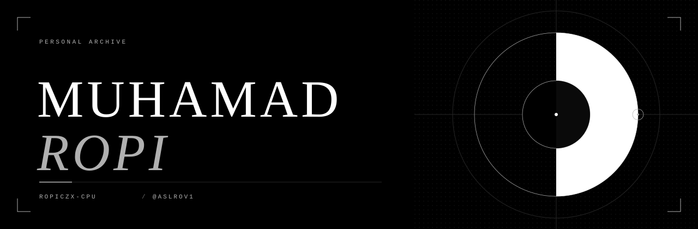

<br>


### Muhamad Ropi

I write code and build small things, mostly in Python, C++ and JavaScript.
This page is my workspace: what I use, where to find me, and a place to listen.

[GitHub](https://github.com/ropiczx-cpu) &nbsp;·&nbsp; [Instagram](https://www.instagram.com/aslrov1/)

<br clear="right">


### Stack

```text
languages   Python · C++ · JavaScript · HTML · CSS · PHP
system      Linux · Bash
tools       Git · GitHub · VS Code · Docker
```


### Listen

A small monochrome player lives on GitHub Pages. GitHub READMEs cannot run scripts,
so it opens on its own page.

[**Open the player →**](https://ropiczx-cpu.github.io/ropiczx-cpu/player.html)


### Contact

Want to collaborate or just talk? Message me on [Instagram, @aslrov1](https://www.instagram.com/aslrov1/).

<br>


